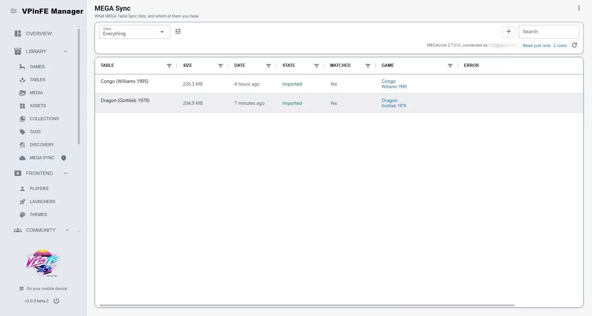

# MEGA Table Sync

> [!WARNING]
> This extension is a work in progress. Expect breaking changes, including to settings and
> to how zips are handled in MEGA, until a stable release.

A [VPinFE](https://github.com/vpinfe/vpinfe) 3 extension that installs table bundles from a MEGA
folder, so your cabinet is ready to play after you switch it on.

## Use case

1. Prepare table files on your phone or tablet while you're away from the cabinet.
2. Upload the bundles to a folder in MEGA.
3. Turn on your cabinet. The extension finds the new bundles and has VPinFE install them, with their media.
4. Play.

When VPinFE starts, the extension finds new zips in the MEGA folder, imports each one with
VPinFE's own importer (which matches the table and fetches artwork), and moves the zip in MEGA.



## Requirements

- [MEGAcmd](https://mega.io/cmd), installed and logged in outside VPinFE.
- Table zips made as `<Folder>.zip`, with everything under one top folder.

## MEGA folder layout

The extension works inside one MEGA folder, `/tables` by default. You only add zips to the top
level. The extension creates and fills the `imported` and `rejected` folders.

```text
/tables
├── Congo (Williams 1995).zip            waiting: installed at the next sync
├── imported/
│   └── Dragon (Gottlieb 1978).zip       installed into your library
└── rejected/
    └── Example (Maker 1990).zip         table already in your library, so not downloaded
```

- Only `.zip` files directly in `/tables` are picked up. The extension doesn't scan the
  subfolders.
- If a zip with the same name is already in `imported` or `rejected`, the new one is moved with
  the date and time added to its name. Nothing there is ever overwritten.
- The extension never deletes anything from MEGA. It only moves zips.

## How it works

The MEGA folder is the only record of what was done. Anything left in it is still to process.

- Installed zips move to `imported` inside the folder.
- Zips for tables already in your library move to `rejected` without downloading. Existing
  tables are never overwritten.
- Failed zips stay in the folder and are tried again at the next start.
- To reinstall a table, remove it from VPinFE, then move its zip back into the MEGA folder.

Files in a bundle that VPinFE doesn't import, such as ROM settings, are copied into the game
folder at their bundle paths. Existing files are never overwritten.

The extension also keeps a small display-only history in `cache/history.json`, with when each zip
was imported or rejected and its last error. Deleting it loses only those times.

## Settings

| Setting | Default | Purpose |
|---|---|---|
| **MEGAcmd Client** | `%LOCALAPPDATA%\MEGAcmd\MEGAclient.exe` | The MEGAcmd client program. |
| **MEGA Folder** | `/tables` | The MEGA folder holding the zips. |
| **Sync When VPinFE Starts** | On | Syncs about 15 seconds after launch. |
| **VPinFE Port** | `8001` | VPinFE's web server port. After an import, the extension asks VPinFE on this device to refresh the library so new tables register. |

Press **Sync Now** in the **MEGA Sync** list (Library) to sync on demand and to see whether
MEGAcmd is installed, its version, and the connected account. If MEGAcmd is missing or logged
out, a row appears under Needs You on Overview.

## Permissions

| Permission | Why |
|---|---|
| `games:read` | Tell which tables are already in your library. |
| `uploads:write` | Import zips through VPinFE's importer. |
| `fs:read` | Let VPinFE read the downloaded zip. |
| `proc:spawn` | Run MEGAcmd. |
| `net:outbound` | MEGAcmd downloads through the network. |
| `config:own` | Keep the extension's settings. |
| `ui:mount` | Show the settings, list and action. |
